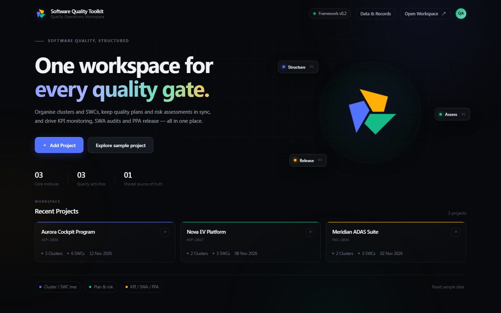
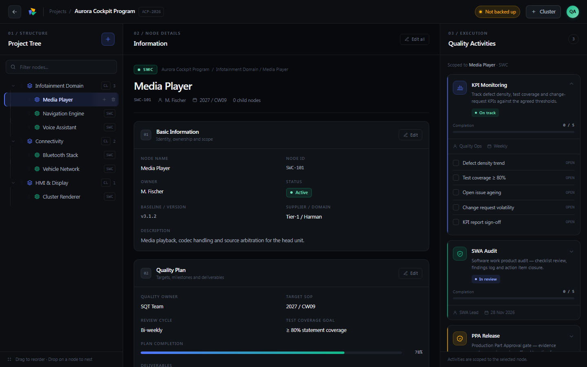
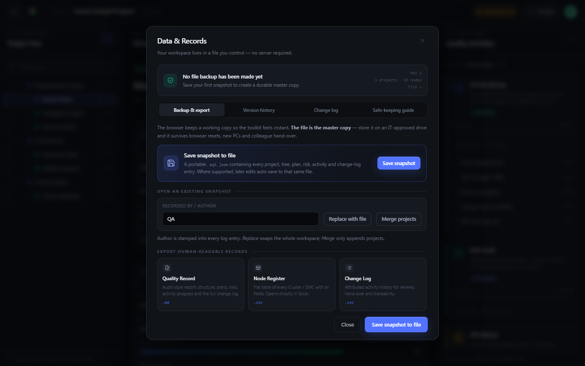
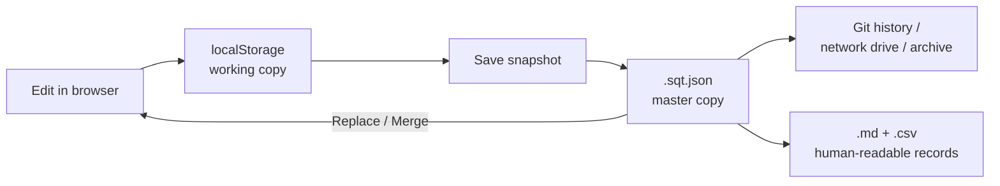

<div align="center">
  
  <h1>Software Quality Toolkit</h1>
  <p><strong>An offline-first workspace for software quality management.</strong></p>
  <p>Structure clusters and SWCs, maintain quality plans and risk assessments, and drive<br>KPI Monitoring, SWA Audit and PPA Release &mdash; without a server.</p>
</div>

---

| | |
| --- | --- |
| **Runs on** | Any modern browser, from a local file or a static host |
| **Stack** | Vanilla HTML / CSS / JavaScript &mdash; no build, no packages, no framework |
| **Network** | Zero requests. Nothing is sent anywhere unless you deliberately export a file |
| **Data** | A portable `.sqt.json` file that you own (the browser is only a working copy) |
| **Version** | `v0.2` &mdash; framework stage |
| **UI language** | English |



---

## Why this exists

Many quality teams cannot deploy an internal web service: locked-down servers, no hosting approval, long IT lead times. This toolkit takes the opposite route. It is a **local HTML application** — double-click it and it opens. There is no backend to approve, no database to provision and no account to create.

The trade-off is that data cannot live in a shared database. The toolkit solves this by treating a **file as the master copy**: you save a snapshot to an IT-approved drive, version-control it if you like, and hand it to a colleague as a zip. The browser keeps a fast working copy, but the interface always tells you whether that copy has been backed up.

> **Company use:** read [Confidentiality](#confidentiality--read-before-you-push) before you push anything.

## What is in the box



**01 / Structure — Project Tree**
Add clusters and SWCs, filter, collapse, delete. Every node can be **held and dragged**: drop above/below to reorder, or drop onto a node to change its parent. Dropping into your own descendants is blocked; a floating ghost, insertion line, target highlight and edge auto-scroll keep the interaction legible.

**02 / Node Details — Information**
Selecting any node shows three independently editable blocks: **Basic Information**, **Quality Plan** and **Risk Assessment**. Edit one block, or use *Edit all*. Renaming a node updates the tree immediately. Field definitions live in the `BLOCKS` schema in `app.js`.

**03 / Execution — Quality Activities**
**KPI Monitoring**, **SWA Audit** and **PPA Release**, each scoped to the selected node, with expandable checklists and a live completion bar. Activity templates live in `ACTIVITY_TEMPLATE` in `app.js`.

**Data & Records** *(see below)* — portable snapshots, version checkpoints, an attributed change log and human-readable exports.



---

## Quick start

### Run locally

```bash
git clone <your-repo-url>
cd <repo>
# no install step
```

Open `SoftwareQualityToolkit.html` in Chrome, Edge, Firefox or Safari. That is the entire setup. To share the toolkit, zip the folder — it is self-contained.

> Opening from `file://` works everywhere. Chromium can additionally **auto-save to a linked snapshot file** on secure origins (`https://` — including GitHub Pages — and `localhost`); on `file://` and in other browsers the toolkit automatically falls back to a normal file download. The linked-file auto-save lasts for the current browser session.

### Publish to GitHub (first time)

Create an **empty, Private** repository on GitHub first — no README, no licence, no `.gitignore` there, so nothing conflicts with the local files. Then:

```bash
cd sqt-toolkit
git init
git status --ignored        # safety check: real snapshots must show as !! (ignored)
git add .
git status                  # verify NO *.sqt.json / SQT_* exports are staged
git commit -m "chore: initial framework and documentation"
git branch -M main
git remote add origin https://github.com/<owner>/<repo>.git
git push -u origin main
```

The `git status` check before committing is not optional ceremony: it is the last guard that keeps company project data out of the repository. If any real snapshot appears in the staged list, stop and fix `.gitignore` before pushing.

### Serve via GitHub Pages

No build workflow is required — this is a static site.

1. Repository **Settings → Pages**
2. **Build and deployment → Deploy from a branch**
3. Select `main` / `(root)` → **Save**
4. Open `https://<owner>.github.io/<repo>/`

`index.html` is a lightweight dark-themed entry that redirects to `SoftwareQualityToolkit.html`, so the named application file is preserved. `.nojekyll` prevents Jekyll from rewriting anything. All asset paths are relative, so a project sub-path works unchanged.

> GitHub Pages publishes the **toolkit shell**, not your data. Each visitor still gets their own browser-local working copy and must import a `.sqt.json` to see project data. Pages does **not** sync data between people. Do not put company data on a public Pages site.

---

## Data & Records

The persistence model has three layers. Only the first one is durable.

| Layer | Where it lives | Survives a new PC / browser reset? | Purpose |
| --- | --- | --- | --- |
| **Snapshot `.sqt.json`** | A drive *you* choose | **Yes** | Master copy, hand-over, archive, version control |
| Browser working copy | `localStorage` | No | Instant re-open on the same machine |
| Version checkpoints | `localStorage` | No | Undo a mistake made minutes ago |

A backup-status indicator in the top bar reads `Not backed up` → `Unsaved to file` (amber) → `Backed up <time>` → `Auto-saved to file`, so you always know whether your work exists outside the browser.

**Recommended routine**

1. Keep the toolkit folder and your snapshots together on an IT-approved drive (mapped network share, managed sync folder, or an internal Git repository).
2. Set **Recorded by / author** before entering real data — every log entry carries that name.
3. At the end of each session open **Data & Records → Backup & export → Save snapshot to file**. Filenames include a second-level timestamp, so successive saves never overwrite one another.
4. Keep at least two copies in two places. Export a human-readable record for reviews.
5. To continue on another machine, open the toolkit and use **Replace with file** (or **Merge projects** to append).

**Exports**

| File | Contents | Typical use |
| --- | --- | --- |
| `SQT_*.sqt.json` | Everything: tree, all three blocks, activities, view state, revision, author and change log | Master copy, Git, hand-over |
| `SQT_QualityRecord_*.md` | Audit-style report with tables, plan/risk notes and the full change log | Review minutes, audits, printing to PDF |
| `SQT_NodeRegister_*.csv` | Flat register of every Cluster / SWC with all fields (UTF-8 BOM for Excel) | Tracking, filtering, reporting |
| `SQT_ChangeLog_*.csv` | Attributed activity history | Traceability, hand-over |

The Chinese-language operating procedure for internal teams is in **[docs/DATA-AND-RECORDS.md](docs/DATA-AND-RECORDS.md)**.

### Snapshot format

Version `1`. A snapshot is a single self-contained JSON document:

```jsonc
{
  "format": "sqt-workspace",
  "version": 1,
  "exportedAt": "2026-11-12T14:00:00.000Z",
  "checksum": "…",              // FNV-1a over the canonical workspace object
  "stats": { "projects": 1, "nodes": 3, "records": 2 },
  "workspace": {
    "schemaVersion": 1,
    "projects": [ /* recursive Cluster / SWC tree + data.{basic,plan,risk} */ ],
    "log": [ /* { ts, by, action, project, node, detail } */ ],
    "settings": { "author": "…" },
    "revision": 3,
    "updatedAt": "…",
    "viewState": { "activeProjectId": "…", "selectedNodeId": "…", "expanded": [/* … */] }
  }
}
```

On import the toolkit validates `format`, checks the version, normalises every node against the schema, warns (without blocking) if the checksum does not match, and then either replaces or merges. A small fictional example you can import to explore the structure is provided at **[examples/sample-workspace.sqt.json](examples/sample-workspace.sqt.json)**.



---

## Confidentiality — read before you push

This repository is designed so that **code is publishable and data is not**.

- Use a **private repository**, or your organisation's GitHub Enterprise instance, for anything beyond the bare framework.
- **Never commit real snapshots or exports.** `.gitignore` excludes `*.sqt.json`, `SQT_*.md` and `SQT_*.csv`. The only snapshot in the repo is the deliberately fictional one under `examples/`.
- The application makes **no network calls** — no analytics, no fonts, no CDN, no telemetry. Data leaves the browser only when you export a file yourself.
- Do not preload company data into a public GitHub Pages site, and do not paste project names, supplier names or defect figures into issues or commit messages.
- If you use an internal Git repository to version snapshots, that repository must be private and follow your company's retention policy.

> If you need multiple people editing the same projects at the same time, this architecture is the wrong tool: there is no concurrency control, no authentication and no access control. A snapshot is owned by one author at a time. Splitting by project and nominating one owner per file works well; true multi-user editing requires a backend.

---

## Repository layout

```
.
├── README.md                         this file
├── LICENSE                           internal-use notice (see below)
├── CHANGELOG.md
├── .gitignore                        keeps real project data out of Git
├── .gitattributes                    LF for source, JSON diffing for snapshots
├── .nojekyll                         GitHub Pages: skip Jekyll
├── index.html                        Pages entry → SoftwareQualityToolkit.html
├── SoftwareQualityToolkit.html       application shell
├── styles.css                        design tokens + all component styles
├── app.js                            state, schema, interactions, persistence
├── assets/
│   └── sqt-logo.png                  transparent SQT mark (also the favicon)
├── docs/
│   ├── DATA-AND-RECORDS.md           Chinese data-handling procedure
│   └── screenshots/                  images used in this README
└── examples/
    └── sample-workspace.sqt.json     fictional snapshot / schema reference
```

**Design system** — the palette is taken directly from the SQT mark: `#5273FF` periwinkle, `#FFAF06` amber, `#14BB87` teal on a near-black `#08090C` ground. Blue maps to Clusters / KPI, teal to SWCs / SWA, amber to PPA / risk. Tokens are defined at the top of `styles.css`. Motion uses only `transform` and `opacity`; dragging runs on `requestAnimationFrame`, so no layout thrash.

## Browser support

| | Chrome / Edge | Firefox / Safari |
| --- | --- | --- |
| Toolkit, drag, editing, exports | ✅ | ✅ |
| Save / open snapshot | ✅ | ✅ (download / file input) |
| Auto-save to a linked file | ✅ on `https://` | — falls back to manual download |
| Version checkpoints, change log | ✅ | ✅ |

Local storage is limited to roughly 5 MB per origin. Archive and prune old snapshots rather than letting the browser cache grow indefinitely.

## Development

No toolchain. Edit the files and refresh the browser.

- **Add or reorder fields:** edit `BLOCKS` in `app.js`. Each block declares its fields with `type` (`text` / `textarea` / `select` / `number`) and optional `display` (`pill` / `progress`).
- **Add an activity:** edit `ACTIVITY_TEMPLATE` in `app.js`.
- **Change the visual system:** edit the `:root` tokens in `styles.css`.
- **Syntax check:** `node --check app.js`
- **Local automation hook:** `window.SQT` exposes `snapshot()`, `record()`, `register()`, `log()`, `importText()` and `status()` for scripted round-trip checks.

The UI is intentionally all-English. Keep new on-screen copy in English; internal documentation may be localised.

## Roadmap

Framework first — concrete capabilities are being added incrementally.

- `v0.3` — agreed field definitions, activity detail pages, snapshot diff / comparison
- `v0.4` — KPI data import, threshold rules and trend views
- Later — review sign-off, templates, and (only if a backend becomes available) multi-user editing and permissions

## Known limitations

- Single-user, last-write-wins. No locking, auth or audit server.
- No server-side backup; durability depends on your own snapshot routine.
- Sample projects are loaded on first run. Use **Data & Records → Safe-keeping guide → Clear samples** before entering real data.
- `localStorage` can be cleared by browser/IT policy at any time.

## License

`LICENSE` currently contains a **restrictive internal-use notice** ("all rights reserved"), chosen as the safe default for a company quality tool. It is a placeholder decision, not a legal recommendation: if you intend to open-source this repository, replace it with MIT or Apache-2.0 and confirm with your organisation's policy first. See [CHANGELOG.md](CHANGELOG.md) for version history.
